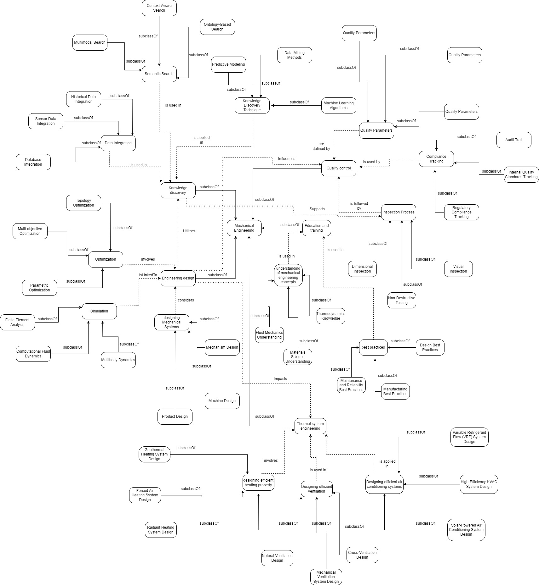
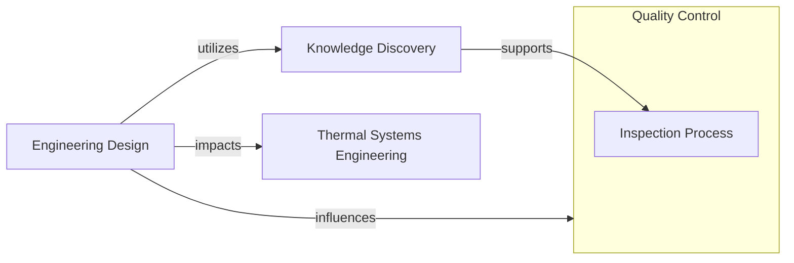

# Ontology in Mechanical Engineering using Knowledge Graphs

> A domain ontology for mechanical engineering, modelled in OWL and presented as a knowledge graph. Browse the concepts visually, open them in an ontology editor, or query them with SPARQL.


[](finalfinalknowledgegraph.jpg)

*Solid arrows are `subClassOf` links; dashed arrows are named relationships between concepts. Click the image to open it full size.*

## Contents

- [Overview](#overview)
- [Repository contents](#repository-contents)
- [Ontology structure](#ontology-structure)
  - [The five aspects](#the-five-aspects)
  - [Class hierarchy](#class-hierarchy)
  - [Relationships](#relationships)
  - [Namespaces](#namespaces)
- [Getting started](#getting-started)
- [Competency questions and SPARQL](#competency-questions-and-sparql)
- [Roadmap](#roadmap)
- [Contributing](#contributing)
- [License and author](#license-and-author)

## Overview

Mechanical engineering spans design, simulation, thermal systems, quality assurance and training. This project captures that breadth in one ontology: every concept is an OWL class with a label and a plain-English description, concepts are arranged in a `subClassOf` hierarchy, and named relationships (*is used in*, *influences*, *supports* and others) connect them across areas.

Together, the classes and relationships form a shared vocabulary that can support data integration, semantic search and knowledge discovery across mechanical-engineering information.

| At a glance | |
|---|---|
| Classes | **62**: 1 root, 5 top-level aspects, 14 mid-level groups, 42 specific classes |
| Relationship types | **12** (for example `IsLinkedTo`, `UsedIn`, `Involves`) |
| Relationship links in the diagram | **18** |
| Competency questions | **6**, each with a SPARQL query |
| Format | OWL, serialised as RDF/XML |

## Repository contents

| File | What it is |
|---|---|
| [`mechanicalEngineeringOntology.rdf`](mechanicalEngineeringOntology.rdf) | The ontology in RDF/XML: classes, labels, descriptions, object properties and relationship triples |
| [`query questions of ontology.txt`](query%20questions%20of%20ontology.txt) | Competency questions with their SPARQL queries |
| [`finalfinalknowledgegraph.jpg`](finalfinalknowledgegraph.jpg) | Diagram of the complete knowledge graph |

## Ontology structure

### The five aspects

Every concept sits under one of five top-level aspects of mechanical engineering:

| Aspect | Covers |
|---|---|
| **Engineering Design** | Simulation (FEA, CFD, multibody dynamics), optimization (topology, parametric, multi-objective) and designing mechanical systems (mechanism, machine and product design) |
| **Knowledge Discovery** | Data integration, semantic search, and knowledge-discovery techniques such as machine learning, data mining and predictive modelling |
| **Quality Control** | Quality parameters, inspection processes (visual, non-destructive, dimensional) and compliance tracking |
| **Education and Training** | Understanding of core concepts (thermodynamics, fluid mechanics, materials science) and best practices (design, manufacturing, maintenance and reliability) |
| **Thermal Systems Engineering** | Efficient heating, ventilation and air-conditioning design |

### Class hierarchy

<details>
<summary>Show the full hierarchy (62 classes)</summary>

```text
Mechanical Engineering
├── Engineering Design
│   ├── Simulation
│   │   ├── Finite Element Analysis (FEA)
│   │   ├── Computational Fluid Dynamics (CFD)
│   │   └── Multibody Dynamics (MBD)
│   ├── Optimization
│   │   ├── Topology Optimization
│   │   ├── Parametric Optimization
│   │   └── Multi-objective Optimization
│   └── Designing Mechanical Systems
│       ├── Mechanism Design
│       ├── Machine Design
│       └── Product Design
├── Knowledge Discovery
│   ├── Data Integration
│   │   ├── Database Integration
│   │   ├── Sensor Data Integration
│   │   └── Historical Data Integration
│   ├── Semantic Search
│   │   ├── Ontology-Based Search
│   │   ├── Context-Aware Search
│   │   └── Multimodal Search
│   └── Knowledge Discovery Technique
│       ├── Machine Learning Algorithms
│       ├── Data Mining Methods
│       └── Predictive Modeling
├── Quality Control
│   ├── Quality Parameters
│   │   ├── Material Quality Parameters
│   │   ├── Product Performance Parameters
│   │   └── Process Quality Parameters
│   ├── Inspection Process
│   │   ├── Visual Inspection
│   │   ├── Non-Destructive Testing (NDT)
│   │   └── Dimensional Inspection
│   └── Compliance Tracking
│       ├── Regulatory Compliance Tracking
│       ├── Internal Quality Standards Tracking
│       └── Audit Trail
├── Education and Training
│   ├── Understanding of Mechanical Engineering Concepts
│   │   ├── Thermodynamics Knowledge
│   │   ├── Fluid Mechanics Understanding
│   │   └── Materials Science Understanding
│   └── Best Practices
│       ├── Design Best Practices
│       ├── Manufacturing Best Practices
│       └── Maintenance and Reliability Best Practices
└── Thermal Systems Engineering
    ├── Designing Efficient Heating
    │   ├── Radiant Heating System Design
    │   ├── Forced Air Heating System Design
    │   └── Geothermal Heating System Design
    ├── Designing Efficient Ventilation
    │   ├── Natural Ventilation Design
    │   ├── Mechanical Ventilation System Design
    │   └── Cross-Ventilation Design
    └── Designing Efficient Air Conditioning Systems
        ├── Variable Refrigerant Flow (VRF) System Design
        ├── High-Efficiency HVAC System Design
        └── Solar-Powered Air Conditioning System Design
```

</details>

### Relationships

Concepts are connected by named relationships, drawn as dashed arrows in the diagram. At the top level, the aspects connect like this:



*Education and Training connects only to the concepts it contains.*

All twelve relationship types, with the links they make in the diagram (arrows read from the first concept to the second):

| Property | Links |
|---|---|
| `IsLinkedTo` | Simulation → Engineering Design |
| `Involves` | Optimization → Engineering Design; Designing Efficient Heating → Thermal Systems Engineering |
| `Considers` | Designing Mechanical Systems → Engineering Design |
| `UsedIn` | Semantic Search → Knowledge Discovery; Data Integration → Knowledge Discovery; Understanding of Mechanical Engineering Concepts → Education and Training; Best Practices → Education and Training; Designing Efficient Ventilation → Thermal Systems Engineering |
| `AppliedIn` | Knowledge Discovery Technique → Knowledge Discovery; Designing Efficient Air Conditioning Systems → Thermal Systems Engineering |
| `UsedBy` | Compliance Tracking → Quality Control |
| `DefinedBy` | Quality Parameters → Quality Control |
| `isfollowedby` | Inspection Process → Quality Control |
| `influencesQualityControl` | Engineering Design → Quality Control |
| `supportsInspectionProcess` | Knowledge Discovery → Inspection Process |
| `utilizesKnowledgeDiscovery` | Engineering Design → Knowledge Discovery |
| `impactsThermalSystemEngineering` | Engineering Design → Thermal Systems Engineering |

`IsLinkedTo` is the only property with a declared `rdfs:domain` (Simulation) and `rdfs:range` (Engineering Design); it is also declared transitive.

### Namespaces

Terms are currently spread over a few base IRIs, so a SPARQL query must use the IRI under which a term is declared:

| Base IRI | Terms |
|---|---|
| `http://www.example.com/MechanicalEngineering#` | The root class `mechanicalEngineering`, the five aspects, the 14 mid-level classes, and the properties `IsLinkedTo`, `UsedIn`, `AppliedIn`, `UsedBy`, `DefinedBy`, `Involves` |
| `http://example.com/MechanicalEngineering#` | The 42 specific classes (for example `FiniteElementAnalysis`), plus the properties `Considers` and `isfollowedby` |
| `http://example.org/` | `influencesQualityControl`, `supportsInspectionProcess`, `utilizesKnowledgeDiscovery`, `impactsThermalSystemEngineering` |

For example, the class `FiniteElementAnalysis` is `http://example.com/MechanicalEngineering#FiniteElementAnalysis`, but its parent `Simulation` is `http://www.example.com/MechanicalEngineering#Simulation`. This is why the queries below start from the parent's IRI.

## Getting started

Clone the repository:

```bash
git clone https://github.com/Inupa6677/Ontology-in-mechanical-engineering-using-knowledge-graphs.git
cd Ontology-in-mechanical-engineering-using-knowledge-graphs
```

### Option A: explore in Protégé

1. Open [Protégé](https://protege.stanford.edu/) and choose **File → Open…**, then select `mechanicalEngineeringOntology.rdf`.
2. Browse the hierarchy under **Entities → Classes** and the relationships under **Object properties**. The **OntoGraf** tab (**Window → Tabs**) draws the classes as a graph.
3. To run the competency queries, open **Window → Tabs → SPARQL Query**, paste a query from the section below and execute it.

### Option B: query with Python

Install [rdflib](https://rdflib.readthedocs.io/):

```bash
pip install rdflib
```

Then load the ontology and run a query:

```python
from rdflib import Graph

g = Graph()
g.parse("mechanicalEngineeringOntology.rdf", format="xml")

query = """
PREFIX rdfs: <http://www.w3.org/2000/01/rdf-schema#>

SELECT ?subclass ?label ?comment
WHERE {
  ?subclass rdfs:subClassOf <http://www.example.com/MechanicalEngineering#Optimization> ;
            rdfs:label ?label ;
            rdfs:comment ?comment .
}
"""

for row in g.query(query):
    print(f"{row.label}: {row.comment}")
```

The file is standard RDF/XML, so it also loads into other triple stores and SPARQL engines.

## Competency questions and SPARQL

The six competency questions below define what the ontology should be able to answer. Each has the SPARQL query from [`query questions of ontology.txt`](query%20questions%20of%20ontology.txt) and the result it returns on the current ontology file (checked by running every query with rdflib).

| # | Question | Returns |
|---|---|---|
| 1 | What categories exist under **Optimization**? | Topology, Parametric and Multi-objective Optimization |
| 2 | What are the specialized categories under **Simulation**? | Finite Element Analysis, Computational Fluid Dynamics, Multibody Dynamics |
| 3 | Which categories fall under **Inspection Process**? | Visual Inspection, Non-Destructive Testing, Dimensional Inspection |
| 4 | What techniques relate to **Designing Efficient Heating**? | Radiant, Forced Air and Geothermal Heating System Design |
| 5 | Which subclasses are **Quality Parameters**? | Material, Product Performance and Process Quality Parameters |
| 6 | Which object property links **Simulation** and **Engineering Design**? | `IsLinkedTo` |

Questions 1–5 follow one pattern: list everything declared as an `rdfs:subClassOf` a given class, with its label and description. The `?subclass` column also returns each class's IRI, which is left out of the result tables for brevity.

<details>
<summary><b>Q1.</b> What specific categories exist under the 'Optimization' class in the context of Mechanical Engineering?</summary>

```sparql
PREFIX rdf: <http://www.w3.org/1999/02/22-rdf-syntax-ns#>
PREFIX rdfs: <http://www.w3.org/2000/01/rdf-schema#>

SELECT ?subclass ?label ?comment
WHERE {
  ?subclass rdfs:subClassOf <http://www.example.com/MechanicalEngineering#Optimization> ;
            rdfs:label ?label ;
            rdfs:comment ?comment .
}
```

| label | comment |
|---|---|
| Topology Optimization | Involves optimizing the material distribution within a given design space to achieve the best structural performance. |
| Parametric Optimization | Focuses on optimizing design parameters to enhance performance while considering constraints. |
| Multi-objective Optimization | Addresses the optimization of multiple conflicting objectives simultaneously in design processes. |

</details>

<details>
<summary><b>Q2.</b> What are the specialized categories under the 'Simulation' class in the context of Mechanical Engineering?</summary>

```sparql
PREFIX rdf: <http://www.w3.org/1999/02/22-rdf-syntax-ns#>
PREFIX rdfs: <http://www.w3.org/2000/01/rdf-schema#>

SELECT ?subclass ?label ?comment
WHERE {
  ?subclass rdfs:subClassOf <http://www.example.com/MechanicalEngineering#Simulation> ;
            rdfs:label ?label ;
            rdfs:comment ?comment .
}
```

| label | comment |
|---|---|
| Finite Element Analysis (FEA) | Deals with simulating and analyzing the behavior of structures and components under various conditions. |
| Computational Fluid Dynamics (CFD) | Focuses on simulating fluid flow and heat transfer in mechanical systems. |
| Multibody Dynamics (MBD) | Involves simulating the motion and interaction of interconnected rigid or flexible bodies. |

</details>

<details>
<summary><b>Q3.</b> Which particular categories fall under the Mechanical Engineering class "Inspection Process"?</summary>

```sparql
PREFIX rdf: <http://www.w3.org/1999/02/22-rdf-syntax-ns#>
PREFIX rdfs: <http://www.w3.org/2000/01/rdf-schema#>

SELECT ?subclass ?label ?comment
WHERE {
  ?subclass rdfs:subClassOf <http://www.example.com/MechanicalEngineering#InspectionProcess> ;
            rdfs:label ?label ;
            rdfs:comment ?comment .
}
```

| label | comment |
|---|---|
| Visual Inspection | Involves the visual examination of mechanical components or products for defects or deviations from quality standards. |
| Non-Destructive Testing (NDT) | Utilizes methods such as ultrasonic testing, radiographic testing, and magnetic particle testing to assess the quality of materials without causing damage. |
| Dimensional Inspection | Focuses on verifying the dimensional accuracy of mechanical components using precision measuring tools. |

</details>

<details>
<summary><b>Q4.</b> What are the specific aspects or techniques related to 'Designing Efficient Heating Property' in the field of Mechanical Engineering?</summary>

```sparql
PREFIX rdf: <http://www.w3.org/1999/02/22-rdf-syntax-ns#>
PREFIX rdfs: <http://www.w3.org/2000/01/rdf-schema#>

SELECT ?subclass ?label ?comment
WHERE {
  ?subclass rdfs:subClassOf <http://www.example.com/MechanicalEngineering#DesigningEfficientHeating> ;
            rdfs:label ?label ;
            rdfs:comment ?comment .
}
```

| label | comment |
|---|---|
| Radiant Heating System Design | Focuses on the design of heating systems that use radiant heat transfer for efficient and comfortable space heating. |
| Forced Air Heating System Design | Involves the design of forced-air heating systems, including considerations for ductwork, heat exchangers, and energy efficiency. |
| Geothermal Heating System Design | Encompasses the design of heating systems that utilize geothermal energy for space heating. |

`DesigningEfficientHeating` is the IRI that the three heating classes point to; the group itself is declared as `EfficientHeatingDesign` (see the [Roadmap](#roadmap)).

</details>

<details>
<summary><b>Q5.</b> Which subclasses in the field of mechanical engineering are classified as "quality parameters"?</summary>

```sparql
PREFIX rdf: <http://www.w3.org/1999/02/22-rdf-syntax-ns#>
PREFIX rdfs: <http://www.w3.org/2000/01/rdf-schema#>

SELECT ?subclass ?label ?comment
WHERE {
  ?subclass rdfs:subClassOf <http://www.example.com/MechanicalEngineering#QualityParameters> ;
            rdfs:label ?label ;
            rdfs:comment ?comment .
}
```

| label | comment |
|---|---|
| Material Quality Parameters | Encompasses parameters related to the quality of materials used in mechanical engineering, such as tensile strength, hardness, and composition. |
| Product Performance Parameters | Includes parameters that measure the performance and functionality of mechanical products, such as efficiency, reliability, and durability. |
| Process Quality Parameters | Focuses on parameters related to manufacturing and production processes, ensuring consistency and quality in the creation of mechanical components. |

</details>

<details>
<summary><b>Q6.</b> What precise relationship or link, as shown by the object property, unites the Mechanical Engineering classes "Simulation" and "Engineering Design"?</summary>

```sparql
PREFIX rdf: <http://www.w3.org/1999/02/22-rdf-syntax-ns#>
PREFIX rdfs: <http://www.w3.org/2000/01/rdf-schema#>
PREFIX owl: <http://www.w3.org/2002/07/owl#>

SELECT ?property ?comment
WHERE {
  ?property rdf:type owl:ObjectProperty ;
            rdfs:domain <http://www.example.com/MechanicalEngineering#Simulation> ;
            rdfs:range <http://www.example.com/MechanicalEngineering#EngineeringDesign> ;
            rdfs:label ?label .
  OPTIONAL { ?property rdfs:comment ?comment }
}
```

This finds the object property whose domain is Simulation and whose range is Engineering Design.

| property | comment |
|---|---|
| `http://www.example.com/MechanicalEngineering#IsLinkedTo` | Property indicating a link between different aspects of mechanical engineering. |

</details>

## Roadmap

- [ ] Attach the five aspect classes to the root class `mechanicalEngineering`. Today each aspect is declared as a subclass of itself, so the root has no subclasses in the RDF file.
- [ ] Use a single base IRI for all classes and properties (see [Namespaces](#namespaces)) and update the queries to match.
- [ ] Point the relationship triples at the declared properties. They currently use an `engineering:` prefix that expands to `http://example.com/engineering…` (for example `…engineeringUsedIn`), which matches no declared property. Add `rdfs:domain` and `rdfs:range` to each property; only `IsLinkedTo` has them today.
- [ ] Reconcile the grouping classes. The leaf classes point to `Designing`, `DesigningEfficientHeating`, `DesigningEfficientVentilation`, `DesigningEfficientAirConditioningSystems` and `UnderstandingOfMechanicalEngineeringConcepts`, none of which is declared. The declared classes are `DesigningMechanicalSystems`, `EfficientHeatingDesign`, `EfficientVentilationDesign`, `EfficientACDesign` and `MechEngConceptsUnderstanding`.
- [ ] Replace the placeholder individuals (such as `SomeSimulationInstance` and `EngineeringDesignInstance`) with real instances: concrete methods, tools and standards.
- [ ] Run a reasoner (for example HermiT) and add disjointness axioms between sibling classes.
- [ ] Add competency questions that exercise the relationships, such as *What does Engineering Design influence?*
- [ ] Add a license and ontology metadata (version, creator, `owl:versionIRI`).

## Contributing

Corrections, new competency questions and extensions are welcome. Please open an issue or a pull request describing the class, property or query you would like to add or change.

## License and author

No license has been chosen yet; please contact the author before reusing the ontology.

Created by [@Inupa6677](https://github.com/Inupa6677).
